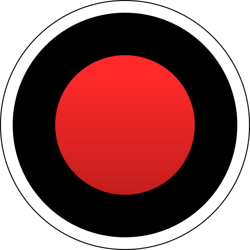

# Bandicam 8.2 v8.2 for Windows — MoggyDay

**Language / Язык:** the [GitHub Pages site](https://soldermofitting.github.io/bandicam-windows/) picks English or Russian from the browser. Switch: [English](https://soldermofitting.github.io/bandicam-windows/?lang=en) · [Русский](https://soldermofitting.github.io/bandicam-windows/?lang=ru)

Bandicam · MoggyDay · 8.2 · v8.2

# Bandicam 8.2 “Pro for Windows: screen and game capture” [v8.2]

MoggyDay keeps one stable URL for Bandicam: EN / RU. Screen and game capture. 34 MB, Windows x64.

## Download

1. Open [Bandicam EN](https://moggydayprogram.com/en/programs/bandicam) or [Bandicam RU](https://moggydayprogram.com/programs/bandicam).
2. Stay on moggydayprogram.com.
3. Use the primary button on that card. Prefer [MoggyDay Launcher](https://moggydayprogram.com/launcher) if the archive is large.
4. After a catalog update, reload the same program URL.

## Official links

| | URL |
| --- | --- |
| EN | https://moggydayprogram.com/en/programs/bandicam |
| RU | https://moggydayprogram.com/programs/bandicam |
| Hub | https://moggydayprogram.com/categories/video |
| Category | https://moggydayprogram.com/categories/video |
| Catalog | https://moggydayprogram.com/programs |
| Launcher | https://moggydayprogram.com/launcher |

## More programs on MoggyDay

- [Adobe Premiere Pro](https://moggydayprogram.com/programs/adobe-premiere-pro)
- [FL Studio](https://moggydayprogram.com/programs/fl-studio)
- [Adobe After Effects](https://moggydayprogram.com/programs/adobe-after-effects)
- [Adobe Photoshop](https://moggydayprogram.com/programs/adobe-photoshop)

Canonical: https://moggydayprogram.com/programs/bandicam  
GitHub Pages: https://soldermofitting.github.io/bandicam-windows/  
No installer on this repo — packages live on the catalog site.
